# SkyRipple

<div align="center">
  
</div>


O SkyRipple é uma aplicação completa de chat em tempo real onde os usuários podem se conectar, entrar em salas temáticas e trocar mensagens instantaneamente tanto na Web quanto em aplicativo móvel nativo Android. O projeto foca em uma experiência rica e nostálgica, trazendo uma estética clean com identidade visual inspirada no Web 2.0 Gloss (Skeuomorfismo e influências do Frutiger Aero) aliada a tecnologias modernas e padrões de segurança de alto nível.

## O que o projeto faz

O SkyRipple funciona como um ecossistema completo de comunicação em tempo real. De forma simples, ele permite:

* Criar conta com verificação em duas etapas (código numérico OTP enviado ao e-mail);
* Recuperar acesso à conta via código numérico de 8 dígitos;
* Visualizar, criar, moderar e favoritar diferentes salas de bate-papo temáticas;
* Entrar em salas e conversar em tempo real com histórico paginado por cursor (`before`, `since` e `limit`);
* Conversar em canais diretos privados 1x1 (Directs) protegidos por Criptografia Ponta a Ponta (E2EE - ECDH P-256 e AES-GCM-256);
* Gravar e reproduzir mensagens de áudio nativas no navegador e compartilhar arquivos e documentos em anexo (até 5 MB);
* Personalizar o perfil completo (foto de exibição, avatar SVG dinâmico, nome público, recado e biografia);
* Usar o sistema de busca textual interna do chat para encontrar mensagens e histórico em tempo real;
* Receber e gerenciar notificações instantâneas com suporte a leitura individual ou em lote;
* Painel administrativo exclusivo para gestão de denúncias, banimentos, monitoramento e métricas globais (`/stats`);
* Navegar com suporte completo a Modo Claro e Modo Escuro com controles de cor e estética Web 2.0 Gloss / Skeuomórfica refinada;
* Aplicativo móvel dedicado (Capacitor Android, pacote `com.skyripple.app`), com navegação por gestos, resposta tátil via haptics e tratamento ergonômico de safe area;
* Autenticação via Google OAuth sincronizada entre Web e Mobile com suporte a Deep Linking (`skyripple://auth/callback`);
* Formatação de datas e horários adaptada nativamente ao fuso horário brasileiro (`America/Sao_Paulo` / padrão 24 horas).

## Qual problema ele resolve

Este projeto foi construído como um projeto prático para a disciplina de Programação Web II. Ele resolve o problema básico de comunicação em tempo real em grupos e conversas privadas, servindo como um excelente laboratório para conectar conceitos avançados de desenvolvimento, tais como:

* Criação de interfaces ricas e responsivas no frontend web e mobile;
* Construção de uma API robusta no backend com arquitetura limpa em camadas (Controller-Service-Repository);
* Autenticação e segurança com JWT, criptografia de senhas com Argon2id/Bcrypt e conformidade CIS Controls IG1 & OWASP ASVS;
* Criptografia ponta a ponta (E2EE) no cliente com chaves assimétricas;
* Comunicação bidirecional de baixa latência em tempo real usando WebSockets;
* Arquitetura visual híbrida, combinando a agilidade do Tailwind CSS com o controle detalhado do CSS para criar efeitos visuais com profundidade;
* Empacotamento híbrido mobile para Android com Capacitor.

## Tecnologias usadas

### Frontend (Web)

* React 19
* Vite
* Tailwind CSS 4
* CSS Híbrido (efeitos Web 2.0 Gloss, brilhos e profundidade)
* React Router DOM
* React Icons
* Socket.IO Client
* Web Crypto API (E2EE ECDH P-256 + AES-GCM)
* Vitest

### Mobile (Android & Capacitor)

* Capacitor 8 (`@capacitor/core`, `@capacitor/android`, `@capacitor/app`, `@capacitor/haptics`, `@capacitor/keyboard`, `@capacitor/status-bar`)
* React 19
* Vite
* Tailwind CSS 4
* Lucide React
* Deep Linking (`skyripple://auth/callback` para login social com Google)
* Pacote Android nativo: `com.skyripple.app` ("SkyRipple")

### Backend

* Node.js
* Express
* Socket.IO
* Supabase (PostgreSQL em nuvem)
* Bibliotecas de segurança e utilidades (bcryptjs, jsonwebtoken, cors, dotenv, helmet e express-rate-limit)
* Arquitetura de banco de dados centralizada no Node.js (Supabase RLS Desativado)
* Testes unitários e de integração (Jest, Supertest, Socket.IO Client)
* ORM (Supabase + Sequelize)
* Documentação OpenAPI 3.0 / Swagger UI

### Ferramentas & Infraestrutura

* Git / GitHub
* Render (deploy do Backend)
* Vercel (Deploy do Frontend Web)
* Android Studio / Gradle (Build do APK Android)
* Playwright (Testes ponta a ponta E2E)
* Supabase (PostgreSQL & Auth)
* npm

## Como rodar localmente

Para testar o projeto no seu computador, primeiro clone o repositório e entre na pasta:

```bash
git clone https://github.com/LucasRamosSilva-15/WebChat.git
cd WebChat
```

*(Nota: substitua a URL acima caso o repositório esteja em outro endereço no GitHub).*

### Frontend (Web)

Em um terminal, entre na pasta do frontend, instale as dependências e inicie o servidor de desenvolvimento:

```bash
cd frontend
npm install
npm run dev
```

Você também precisará criar um arquivo `.env` na raiz da pasta `frontend`:

```env
VITE_BACKEND_URL=http://localhost:3001
VITE_API_URL=http://localhost:3001/api
VITE_SUPABASE_URL=sua_url_do_supabase
VITE_SUPABASE_ANON_KEY=sua_chave_anonima_do_supabase
```

### Mobile (Capacitor / Android)

Para rodar a interface móvel no navegador em modo de desenvolvimento:

```bash
cd mobile
npm install
npm run dev
```

Crie o arquivo `.env` na raiz da pasta `mobile`:

```env
VITE_BACKEND_URL=https://skyripple-9vqr.onrender.com
VITE_API_URL=https://skyripple-9vqr.onrender.com/api
VITE_SUPABASE_URL=sua_url_do_supabase
VITE_SUPABASE_ANON_KEY=sua_chave_anonima_do_supabase
```

Para compilar e sincronizar com o projeto Android nativo:

```bash
# Compilar a SPA mobile e atualizar os assets do Android nativo
npm run build
npx cap sync android

# Abrir o projeto no Android Studio para gerar o APK ou depurar no emulador/dispositivo
npx cap open android
```

### Backend

Em outro terminal, entre na pasta do backend, instale as dependências e inicie o servidor:

```bash
cd backend
npm install
npm run dev
```

Crie um arquivo `.env` na raiz da pasta `backend` com as variáveis necessárias (ajuste as chaves do Supabase e o JWT_SECRET conforme o seu ambiente):

```env
PORT=3001
JWT_SECRET=sua_chave_secreta_aqui
USE_MOCK_DB=false
SUPABASE_URL=sua_url_do_supabase
SUPABASE_ANON_KEY=sua_chave_anonima_do_supabase
FRONTEND_URL=http://localhost:5173
```

## Testes automatizados

O repositório conta com cobertura abrangente de testes automatizados unitários, de integração e ponta a ponta (E2E):

```bash
# Executar todos os testes de Backend e Frontend
npm run test

# Executar apenas os testes do Backend (Jest / Supertest - 182 testes em 18 suítes)
npm run test:backend

# Executar apenas os testes do Frontend (Vitest - 136 testes em 20 suítes)
npm run test:frontend

# Executar a suíte de testes ponta a ponta E2E (Playwright)
npm run test:e2e
```

## Link do deploy

* **Frontend Web:** [https://skyripple-project-web2.vercel.app](https://skyripple-project-web2.vercel.app/)
* **Backend/API (SkyRipple):** [https://skyripple-9vqr.onrender.com](https://skyripple-9vqr.onrender.com)
* **Backend/API (Legado):** [https://webchat-9vqr.onrender.com](https://webchat-9vqr.onrender.com)

## Imagens / Screenshots

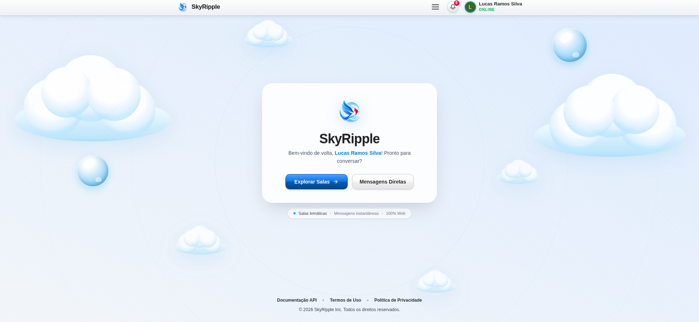
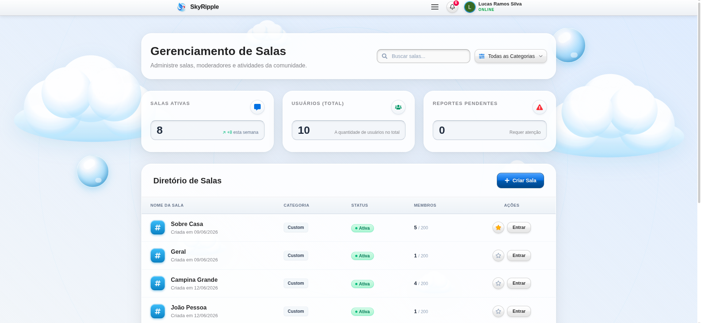
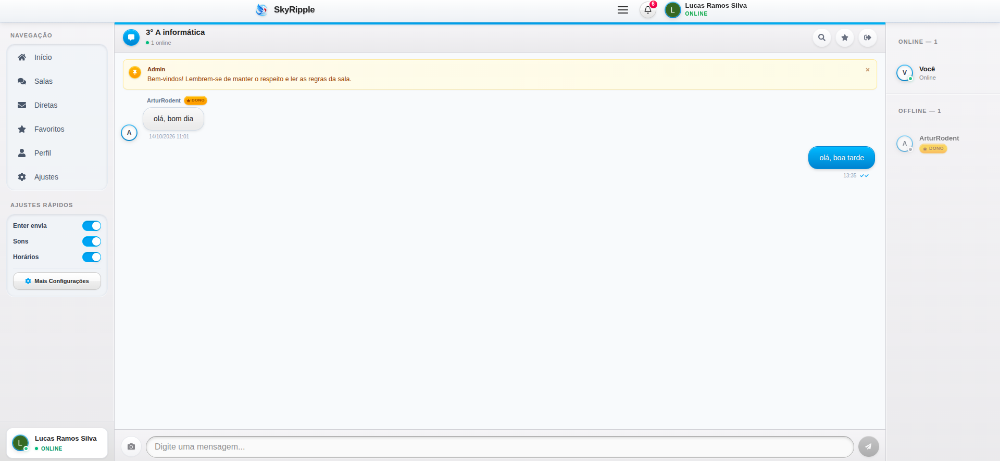
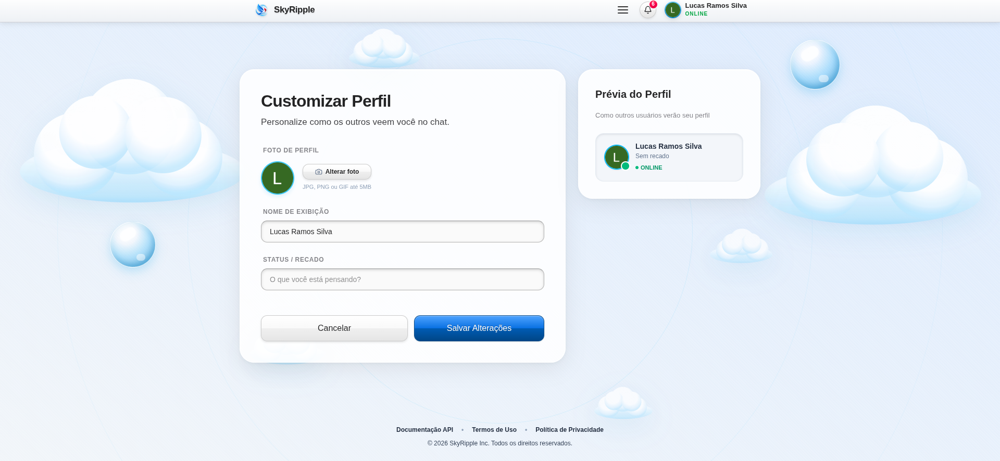
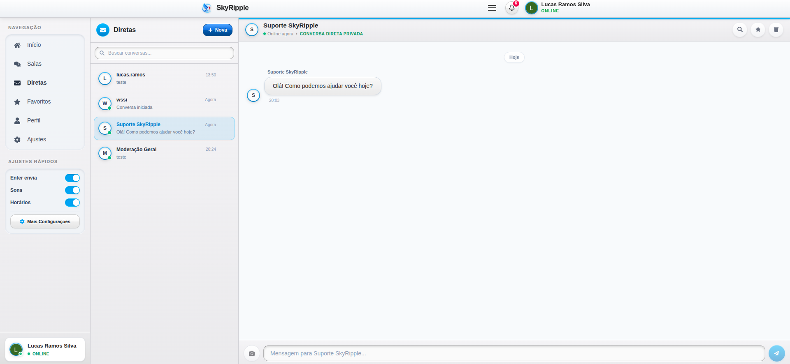
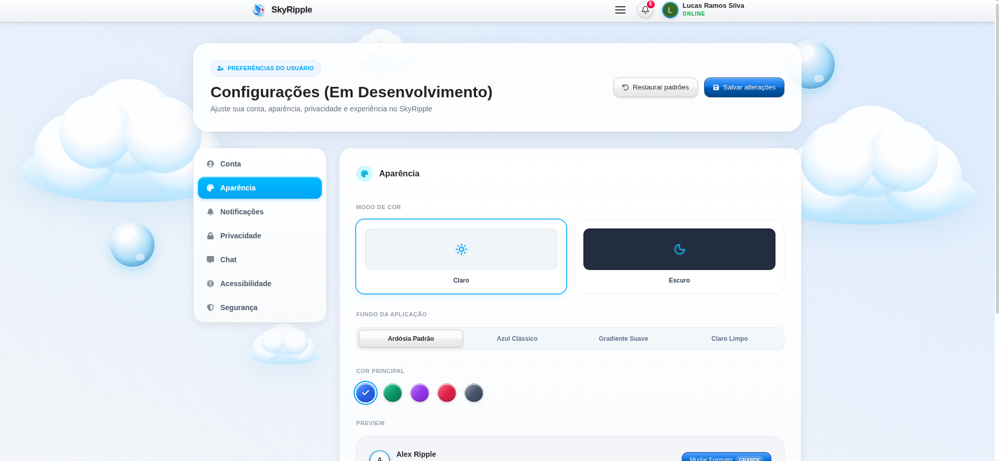
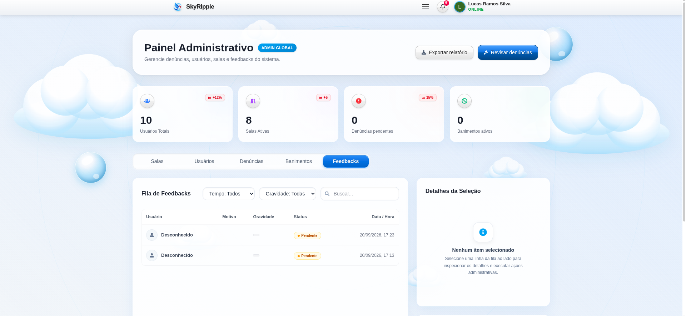

## Funcionalidades

* [x] Página inicial (Home) com design convidativo e navegação intuitiva
* [x] Login e Cadastro de contas com autenticação JWT e senhas criptografadas com Argon2id/Bcrypt
* [x] Autenticação social com Google OAuth e sincronização segura de perfis
* [x] Listagem e favoritação de salas com atualização instantânea
* [x] Chat em tempo real (envio e recebimento de mensagens instantâneas via WebSockets)
* [x] Busca avançada dentro do chat (filtro em tempo real e navegação entre resultados)
* [x] Customização de perfil do usuário (avatar, nome de exibição e recado/status)
* [x] Temas visuais: Modo Claro e Modo Escuro com estética Skeuomórfica / Web 2.0 Gloss
* [x] Layout responsivo na Web e aplicativo nativo dedicado no Android (Capacitor)
* [x] Envio de imagens e anexos com compressão no cliente (arquivos até 5 MB e mensagens de áudio)
* [x] Refinamentos na persistência e histórico de mensagens com paginação por cursor (`before`, `since` e `limit`)
* [x] Mensagens Diretas (Directs / Chat Privado) com histórico persistido e conversas individuais
* [x] Criptografia Ponta-a-Ponta (*E2EE*) em conversas diretas com chaves assimétricas (ECDH P-256 + AES-GCM-256) via Web Crypto API (Web & Mobile)
* [x] Central de Notificações em tempo real com contador de não-lidas e sincronização via WebSockets
* [x] Sistema de Dono de Sala e Moderação Hierárquica (Promover/Rebaixar moderadores, Expulsar participantes, Transferir liderança da sala e Moderação de mensagens)
* [x] Edição de dados da sala (nome e descrição) pelo Dono da Sala
* [x] Sistema de denúncias (Reports) e feedback integrado com suporte a anexos de imagem
* [x] Painel Administrativo centralizado (Admin Dashboard) com métricas em tempo real (`/stats`)
* [x] Verificação de código numérico OTP em duas etapas no cadastro (6 dígitos) e recuperação de senha (8 dígitos)
* [x] Rotina resiliente de logout com timeout defensivo de 2s e expurgo estrito de chaves de sessão
* [x] Aplicativo móvel dedicado (Capacitor Android) com pacote `com.skyripple.app`, feedback tátil (`@capacitor/haptics`) e layout ergonômico
* [x] Deep Linking nativo no mobile (`skyripple://auth/callback`) para login Google OAuth
* [x] Localização temporal no padrão brasileiro (`America/Sao_Paulo` / 24h) em chats, directs e listagens
* [x] Testes automatizados (182 testes no backend com Jest/Supertest e 136 testes no frontend com Vitest — 318 testes no total 100% aprovados)
* [x] Suíte de testes ponta a ponta (E2E) com Playwright cobrindo fluxos críticos
* [x] Documentação interativa da API (Swagger UI local/produção e Mintlify)
* [x] Endurecimento de Segurança CIS Controls IG1 & OWASP ASVS (Rate Limiting rigoroso, Helmet com HSTS, Sanitização XSS, Auditoria de Segurança)

## Estrutura do projeto

```txt
.
├── backend/
│   ├── src/
│   │   ├── app.js                      # Configuração Express, middlewares e rotas
│   │   ├── config/
│   │   │   ├── cors.js                 # Whitelist CORS e validação de origens
│   │   │   ├── database.js             # Conexão e pooling Sequelize / Supabase
│   │   │   └── swagger.js              # Especificação OpenAPI e Swagger UI
│   │   ├── controllers/
│   │   │   ├── AdminController.js
│   │   │   ├── DirectController.js
│   │   │   ├── FeedbackController.js
│   │   │   ├── MessageController.js
│   │   │   ├── NotificationController.js
│   │   │   ├── ReportController.js
│   │   │   ├── RoomController.js
│   │   │   ├── StatsController.js
│   │   │   ├── UsuarioController.js
│   │   │   └── errorHandler.js         # Mapeamento centralizado de erros e HTTP status
│   │   ├── middleware/
│   │   │   ├── auth.js                 # Validação JWT e identificação de usuário
│   │   │   └── adminAuth.js            # Proteção de rotas administrativas
│   │   ├── models/
│   │   │   ├── DirectConversation.js
│   │   │   ├── DirectMessage.js
│   │   │   ├── Favorite.js
│   │   │   ├── Feedback.js
│   │   │   ├── Message.js
│   │   │   ├── Notification.js
│   │   │   ├── Report.js
│   │   │   ├── Room.js
│   │   │   ├── RoomMember.js
│   │   │   ├── User.js
│   │   │   └── index.js
│   │   ├── repositories/
│   │   │   ├── DirectRepository.js
│   │   │   ├── FavoriteRepository.js
│   │   │   ├── FeedbackRepository.js
│   │   │   ├── MessageRepository.js
│   │   │   ├── NotificationRepository.js
│   │   │   ├── ReportRepository.js
│   │   │   ├── RoomMemberRepository.js
│   │   │   ├── RoomRepository.js
│   │   │   └── UserRepository.js
│   │   ├── routes/
│   │   │   ├── admin.js                # Rotas do painel administrativo
│   │   │   ├── api.js                  # Roteador central de APIs
│   │   │   ├── directRoutes.js         # Mensagens diretas privadas
│   │   │   ├── favoriteRoutes.js       # Gestão de favoritos
│   │   │   ├── feedbackRoutes.js       # Relatos de feedback
│   │   │   ├── messageRoutes.js        # Mensagens de salas e busca textual
│   │   │   ├── notificationRoutes.js   # Notificações em tempo real
│   │   │   ├── reportRoutes.js         # Denúncias de moderação
│   │   │   ├── roomRoutes.js           # Rotas de salas e moderação
│   │   │   └── usuarioRoutes.js        # Autenticação, perfil e sincronização OAuth
│   │   ├── services/
│   │   │   ├── DirectService.js
│   │   │   ├── FavoriteService.js
│   │   │   ├── FeedbackService.js
│   │   │   ├── MessageService.js
│   │   │   ├── NotificationService.js
│   │   │   ├── ReportService.js
│   │   │   ├── RoomService.js          # Lógica de negócio, cargos e moderação
│   │   │   └── UserService.js
│   │   ├── sockets/                    # Arquitetura modular de WebSockets (Socket.io)
│   │   │   ├── chatHandler.js          # Handlers de chat em salas e mensagens diretas
│   │   │   ├── index.js                # Instanciação e bootstrap de sockets
│   │   │   ├── presence.js             # Mapeamento de presença ativa por sala e global
│   │   │   └── socketAuth.js           # Middleware de handshake com validação JWT
│   │   └── utils/
│   │       ├── auditLogger.js          # Auditoria de segurança estruturada
│   │       └── security.js             # Criptografia, JWT e sanitização XSS
│   ├── tests/                          # 18 suítes e 182 testes Jest/Supertest
│   │   ├── attachments.test.js
│   │   ├── authMiddleware.test.js
│   │   ├── chat.test.js
│   │   ├── controllers.test.js
│   │   ├── directs.test.js
│   │   ├── e2e-flow.test.js
│   │   ├── e2ee-keys.test.js
│   │   ├── favorites.test.js
│   │   ├── feedback.test.js
│   │   ├── helpers.js
│   │   ├── message.test.js
│   │   ├── models.test.js
│   │   ├── oauthSync.test.js
│   │   ├── pagination.test.js
│   │   ├── report.test.js
│   │   ├── room.test.js
│   │   ├── roomModeration.test.js
│   │   ├── security.test.js
│   │   └── usuario.test.js
│   ├── server.js                       # Bootstrap HTTP, binding de porta e Sequelize
│   ├── package.json
│   └── README.md                       # Documentação técnica profunda do backend
├── docs/                               # Documentação técnica e Mintlify
├── e2e/                                # Suíte automatizada de testes ponta a ponta (Playwright)
│   ├── fixtures/                       # Fixtures isoladas e SQLite em memória
│   ├── tests/                          # Cenários E2E (auth, chat, directs, pagination, audio)
│   └── playwright.config.js
├── frontend/                           # Aplicação Web SPA (React 19 + Vite + Tailwind 4)
│   ├── src/
│   │   ├── assets/                     # SVGs, ícones e recursos visuais
│   │   ├── components/
│   │   │   ├── MembersSidebar.jsx      # Painel de membros e moderação tátil
│   │   │   ├── ChatSidebar.jsx         # Lista de conversas e salas no chat
│   │   │   ├── Navbar.jsx              # Barra superior e navegação
│   │   │   ├── NotificationsDropdown.jsx # Dropdown de notificações em tempo real
│   │   │   ├── OtpCodeInput.jsx        # Seletor numérico de slots OTP
│   │   │   ├── UserAvatar.jsx          # Avatar com indicador de presença
│   │   │   └── ...
│   │   ├── context/
│   │   │   └── NotificationContext.jsx # Estado global de notificações
│   │   ├── pages/
│   │   │   ├── Home.jsx
│   │   │   ├── Chat.jsx                # Interface principal de conversação
│   │   │   ├── Directs.jsx             # Mensagens diretas (1-a-1)
│   │   │   ├── Rooms.jsx               # Catálogo e criação de salas
│   │   │   ├── Admin.jsx               # Painel administrativo do sistema
│   │   │   ├── Feedback.jsx            # Formulário de feedback e suporte
│   │   │   ├── Settings.jsx            # Configurações do perfil
│   │   │   └── ...
│   │   ├── services/
│   │   │   ├── api.js                  # Cliente fetch autenticado
│   │   │   ├── attachments.js          # Conversão de áudio e arquivos
│   │   │   └── e2ee.js                 # Criptografia Web Crypto ECDH/AES-GCM
│   │   ├── styles/
│   │   │   ├── skeuo.css               # Tokens de design Web 2.0 Gloss
│   │   │   └── chat.css
│   │   ├── tests/                      # 20 suítes e 136 testes Vitest
│   │   │   ├── attachments.test.jsx
│   │   │   ├── auth.test.jsx
│   │   │   ├── chat.test.jsx
│   │   │   ├── directs-e2ee.test.jsx
│   │   │   ├── e2ee.test.js
│   │   │   ├── logout.test.jsx
│   │   │   ├── otp.test.jsx
│   │   │   └── ...
│   │   ├── App.jsx                     # Rotas e layout principal
│   │   ├── socket.js                   # Instância global do Socket.IO Client
│   │   ├── main.jsx                    # Ponto de montagem React 19
│   │   └── index.css                   # Tailwind 4 e estilos base
│   ├── vite.config.js
│   ├── package.json
│   └── .env
├── mobile/                             # Aplicativo móvel dedicado (Capacitor 8 + React 19)
│   ├── android/                        # Projeto nativo Android (Gradle, Manifest, APK SkyRipple)
│   ├── src/
│   │   ├── components/mobile/          # MobileHeader, BottomNavigation, etc.
│   │   ├── pages/                      # Telas adaptadas para experiência mobile
│   │   │   ├── Chat.jsx                # Conversas com cabeçalho seguro e safe-area
│   │   │   ├── Directs.jsx             # Directs 1x1 E2EE e ordenação temporal brasileira
│   │   │   ├── Favorites.jsx           # Salas e conversas favoritas
│   │   │   ├── Feedback.jsx            # Envio de feedback do app
│   │   │   ├── ForgotPassword.jsx      # Recuperação de senha com OTP
│   │   │   ├── Login.jsx               # Login e autenticação Google com Deep Linking
│   │   │   ├── Profile.jsx             # Gerenciamento de perfil e avatar
│   │   │   ├── Register.jsx            # Cadastro de nova conta
│   │   │   ├── Rooms.jsx               # Navegação e busca em salas
│   │   │   ├── Settings.jsx            # Configurações de tema e aparência
│   │   │   └── Suporte.jsx             # Central de ajuda e FAQ
│   │   ├── utils/
│   │   │   └── dateUtils.js            # Utilitários de fuso horário brasileiro (America/Sao_Paulo)
│   │   ├── App.jsx                     # Roteamento mobile, Deep Linking e tratamento de sessão
│   │   ├── main.jsx
│   │   └── index.css
│   ├── capacitor.config.json           # Configuração do appId com.skyripple.app
│   ├── vite.config.js
│   ├── package.json
│   └── .env
└── README.md
```

## Catálogo de Páginas Principais (Frontend Web)

A aplicação web é composta por 18 telas com design skeuomórfico reativo:

| Página | Rota | Componente | Guarda | Propósito & Funcionalidades |
| :--- | :--- | :--- | :--- | :--- |
| **Página Inicial** | `/` | `Home.jsx` | Pública | Landing page de apresentação e ponto de entrada da aplicação. |
| **Login** | `/login` | `Login.jsx` | Pública | Autenticação com e-mail/senha, emissão de JWT e alertas contextuais. |
| **Cadastro** | `/register` | `Register.jsx` | Pública | Criação de conta com medidor de força de senha em tempo real. |
| **Recuperação de Senha** | `/forgot-password` | `ForgotPassword.jsx` | Pública | Solicitação de link de redefinição de senha com Supabase Auth. |
| **Lobby de Salas** | `/rooms` | `Rooms.jsx` | `PrivateRoute` | Catálogo de salas temáticas, métricas em tempo real (`StatCard`) e filtros. |
| **Sala de Chat** | `/chat` | `Chat.jsx` | `PrivateRoute` | Mensageria instantânea com Socket.io, criptografia e moderação hierárquica. |
| **Mensagens Diretas** | `/directs` | `Directs.jsx` | `PrivateRoute` | Bate-papo 1x1 confidencial em tempo real, lista de conversas e busca de contatos. |
| **Chat Direto (Alias)** | `/direct` | `Directs.jsx` | `PrivateRoute` | Rota alternativa de acesso rápido ao chat privado. |
| **Favoritos** | `/favorites` | `Favorites.jsx` | `PrivateRoute` | Hub de salas e conversas favoritas para acesso rápido. |
| **Personalização** | `/custom` | `Custom.jsx` | `PrivateRoute` | Edição de foto de perfil, avatar dinâmico, nome público e bio. |
| **Configurações** | `/settings` | `Settings.jsx` | `PrivateRoute` | Temas (Claro/Escuro), densidade de layout, cores de destaque e sons. |
| **Feedback** | `/feedback` | `Feedback.jsx` | `PrivateRoute` | Canal de envio de sugestões e bugs com upload de fotos em cavidade `.skeuo-well`. |
| **Central de Suporte**| `/suporte` | `Suporte.jsx` | `PrivateRoute` | FAQ acordeão interativo, status da plataforma e transparência de moderação. |
| **Sobre o Projeto** | `/about` | `About.jsx` | Pública | Apresentação acadêmica, história do projeto e equipe de desenvolvedores. |
| **Portal Admin Login**| `/admin-login`| `AdminLogin.jsx` | Pública | Autenticação administrativa com chave mestra do sistema. |
| **Painel de Moderação**| `/admin` | `Admin.jsx` | `AdminRoute` | Console de métricas `/stats`, banimentos, gestão de denúncias e salas. |
| **Bancada de Testes** | `/buttons` | `ButtonsTest.jsx`| Pública | Showcase vivo de todos os tokens e componentes táteis SDS. |
| **Não Encontrado** | `*` | `NotFound.jsx` | Pública | Página 404 personalizada com bússola 3D e navegação de resgate. |

## Catálogo de Telas (Mobile Android)

O aplicativo móvel dedicado conta com 11 telas com layout ergonômico, navegação inferior (`BottomNavigation`) e barra de status integrada:

| Tela | Rota | Componente | Descrição & Experiência Mobile |
| :--- | :--- | :--- | :--- |
| **Login** | `/login` | `Login.jsx` | Autenticação por e-mail/senha e login social com Google via Deep Linking. |
| **Cadastro** | `/register` | `Register.jsx` | Cadastro com validação de código OTP e passos otimizados para toque. |
| **Recuperação de Senha** | `/forgot-password` | `ForgotPassword.jsx` | Validação de código numérico de 8 dígitos e definição de nova senha. |
| **Lobby de Salas** | `/rooms` | `Rooms.jsx` | Exploração tátil de salas temáticas com contadores de presença em tempo real. |
| **Sala de Chat** | `/chat/:id` | `Chat.jsx` | Chat em tempo real com envio de anexos, gravação de áudio e header translúcido. |
| **Mensagens Diretas** | `/directs` | `Directs.jsx` | Lista de conversas privadas 1x1 com proteção E2EE e busca de contatos. |
| **Conversa Direta** | `/direct/:id` | `Directs.jsx` | Bate-papo 1x1 cifrado, identificação precisa do remetente (`isMe`) e horário local. |
| **Favoritos** | `/favorites` | `Favorites.jsx` | Acesso rápido às salas e conversas favoritas do usuário. |
| **Perfil** | `/profile` | `Profile.jsx` | Gerenciamento de foto de perfil, avatar dinâmico e biografia. |
| **Configurações** | `/settings` | `Settings.jsx` | Preferências de exibição e alternância instantânea entre Modo Claro e Escuro. |
| **Feedback & Suporte** | `/feedback`, `/support` | `Feedback.jsx`, `Suporte.jsx` | FAQ interativo e canal direto de relatos com suporte a rolagem fluida. |

## Status atual

O projeto **SkyRipple** encontra-se em estado avançado de maturidade técnica, estabilidade e conformidade arquitetural:
* **Frontend Web & Mobile**: Experiência unificada e consistente em Desktop e Android. Conta com interface skeuomórfica refinada (Modo Claro/Escuro), chat em salas públicas e privadas, mensagens diretas com E2EE (Directs), fluxo de cadastro e recuperação com código OTP, central de notificações em tempo real, painel administrativo e interface tátil de moderação de sala.
* **Aplicativo Android Nativo**: Totalmente operacional via Capacitor 8 com pacote `com.skyripple.app`, feedback tátil (`@capacitor/haptics`), deep linking nativo para login social e tratamento contra artefatos visuais de GPU no cabeçalho translúcido.
* **Backend**: Arquitetura profissional em camadas (Controllers, Services, Repositories e Models ORM com Sequelize e Supabase PostgreSQL), auto-migração resiliente de esquema, endurecimento de segurança baseado nos padrões **CIS Controls IG1 & OWASP ASVS**, logs estruturados de auditoria, suíte robusta com **182 testes automatizados no backend e 128 testes no frontend (310 testes no total) 100% aprovados** e documentação Swagger 3.0 interativa.

## Link da documentação Swagger

* **Produção (SkyRipple):** <https://skyripple-9vqr.onrender.com/api-docs/>
* **Produção (Legado):** <https://webchat-9vqr.onrender.com/api-docs/>
* **Local:** <http://localhost:3001/api-docs/>

### Cobertura da Documentação OpenAPI 3.0
A documentação interativa via Swagger UI reflete 100% dos contratos da API:
* **40 Rotas Documentadas** categorizadas em 9 tags (`Auth`, `Rooms`, `Messages`, `Directs`, `Notifications`, `Favorites`, `Reports`, `Feedbacks`, `Admin`).
* **13 Schemas Canônicos**: `User`, `PublicKeyJwk`, `AttachmentInput`, `Room`, `RoomMember`, `Message`, `DirectConversation`, `DirectMessage`, `Notification`, `Favorite`, `Report`, `Feedback` e `ErrorResponse`.
* **Autenticação Interativa**: Suporte a autorização no Swagger UI com token JWT (`BearerAuth`) e chave administrativa (`AdminAuth`).

## Link da documentação Mintlify

<https://lucas-ramos.mintlify.site/guides/overview>

## Funcionalidades Recentes & Entregas Concluídas

* **Aplicativo Mobile Nativo (Capacitor 8 Android)**: Empacotamento híbrido de alto desempenho ("SkyRipple", ID `com.skyripple.app`), com navegação inferior ergonômica, safe-area insets automáticos, resposta tátil via `@capacitor/haptics` e renderização estável sem artefatos de GPU.
* **Deep Linking & Ponte de Autenticação Social**: Integração de esquema de URL nativo (`skyripple://auth/callback`) conectando o fluxo web de OAuth ao app móvel, permitindo login transparente com Google.
* **Criptografia Ponta-a-Ponta (E2EE) no Web & Mobile**: Criptografia assimétrica ponta a ponta no cliente para conversas diretas 1x1 via Web Crypto API (par de chaves ECDH P-256, chave AES-GCM-256 bits, envelope cifrado `e2ee:v1:...` e armazenamento cego no servidor).
* **Fuso Horário Brasileiro e Identificação de Mensagens (`isMe`)**: Formatação temporal estrita no padrão brasileiro (`America/Sao_Paulo` / 24h) e algoritmo resiliente de identificação de autoria de mensagens, garantindo alinhamento perfeito de balões na conversa.
* **Paginação por Cursor no Histórico**: Implementação de parâmetros `before`, `since` e `limit` com índices compostos B-Tree (`idx_messages_room_created_at`, `idx_direct_messages_conv_created_at`) para rolagem infinita instantânea em salas e directs.
* **Mídias e Anexos Multimídia**: Suporte nativo à gravação e reprodução de áudio no navegador e compartilhamento de documentos e imagens em anexo (até 5 MB) em base64 Data URL.
* **Verificação de Código OTP**: Fluxo de cadastro em duas etapas com código numérico OTP de 6 dígitos e recuperação de senha com código numérico de 8 dígitos integrado ao Supabase.
* **Resiliência de Logout**: Rotina com timeout defensivo de 2s com `Promise.race`, encerramento de WebSocket, expurgo estrito de chaves de sessão locais e emissão do evento global `profileUpdated`.
* **Limpeza e Padronização do Código**: Base de código integralmente limpa e profissional, preservando 100% dos comentários contratuais Swagger OpenAPI 3.0 para a documentação interativa.
* **Cobertura Completa de Testes**: Suíte de 310 testes automatizados (182 testes de backend, 128 testes de frontend e suíte ponta a ponta Playwright) com 100% de aprovação.

## Próximos passos

* **Chamadas de Voz e Vídeo P2P (WebRTC)**: Estabelecer sinalização via Socket.io para comunicação de áudio e vídeo de baixa latência ponto a ponto.
* **Notificações Push Nativas (Web Push & Firebase Cloud Messaging)**: Alertar usuários sobre novas mensagens mesmo com o app fechado ou em segundo plano.
* **Sincronização Offline com IndexedDB**: Cache local de histórico e mensagens pendentes para envio automático ao restabelecer conectividade.
* **Reações Rápidas com Emojis**: Sistema tátil de reações em balões de mensagens com sincronização em tempo real na sala.

## Diagramas Arquiteturais & de Modelagem

### 1. Diagrama de Arquitetura da Solução

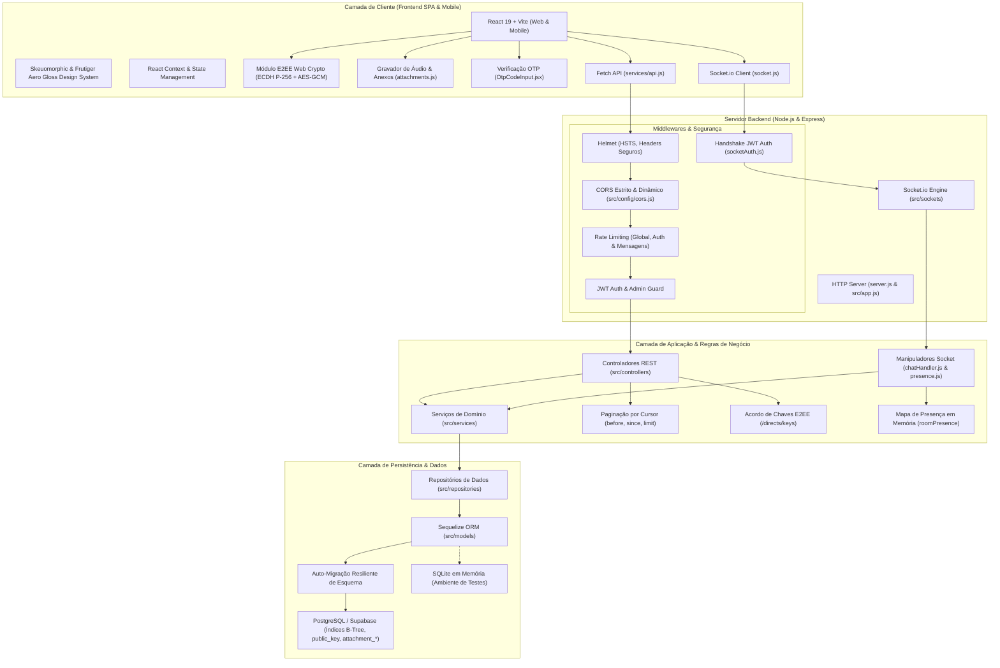

### 2. Diagrama de Fluxo de Mensageria em Tempo Real & Criptografia E2EE

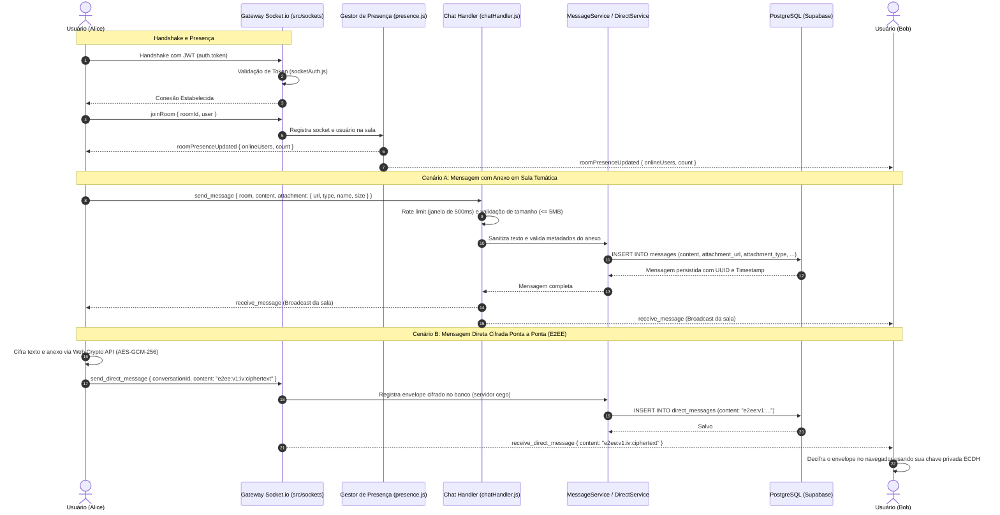

### 3. Diagrama de Autenticação Híbrida, Recuperação de Senha & Fluxo OTP

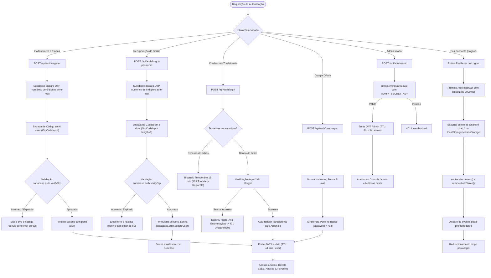

### 4. Diagrama Entidade-Relacionamento (DER)

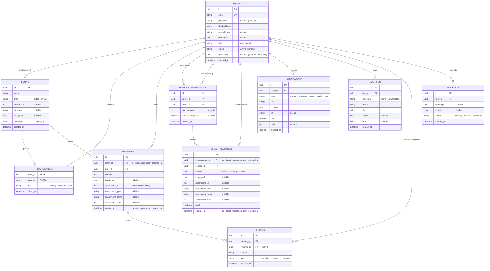

### 5. Diagrama de Classes & Arquitetura em Camadas (Controller-Service-Repository)

```mermaid
classDiagram
    direction TB

    class UsuarioController {
        +register(req, res)
        +login(req, res)
        +me(req, res)
        +deleteProfile(req, res)
        +list(req, res)
        +updateStatus(req, res)
        +oauthSync(req, res)
    }

    class RoomController {
        +create(req, res)
        +list(req, res)
        +getById(req, res)
        +update(req, res)
        +remove(req, res)
        +join(req, res)
        +getMembers(req, res)
        +updateMemberRole(req, res)
        +kickMember(req, res)
        +transferOwnership(req, res)
    }

    class MessageController {
        +send(req, res)
        +listByRoom(req, res)
        +remove(req, res)
        +search(req, res)
    }

    class DirectController {
        +listConversations(req, res)
        +getOrCreate(req, res)
        +listMessages(req, res)
        +sendMessage(req, res)
        +removeConversation(req, res)
        +listUsers(req, res)
        +setPublicKey(req, res)
        +getPublicKey(req, res)
    }

    class NotificationController {
        +list(req, res)
        +create(req, res)
        +markAsRead(req, res)
        +markAllAsRead(req, res)
        +remove(req, res)
        +clearAll(req, res)
    }

    class FavoriteController {
        +list(req, res)
        +create(req, res)
        +remove(req, res)
    }

    class ReportController {
        +create(req, res)
        +list(req, res)
        +updateStatus(req, res)
        +remove(req, res)
    }

    class FeedbackController {
        +create(req, res)
        +list(req, res)
        +updateStatus(req, res)
        +remove(req, res)
    }

    class AdminController {
        +auth(req, res)
    }

    class StatsController {
        +getGlobalStats(req, res)
    }

    class UserService {
        +register(data) Object
        +login(email, password) Object
        +syncOAuthUser(data) Object
        +getAllUsers() List~User~
        +getUserById(id) User
        +updateStatus(id, status) User
        +deleteUser(id) boolean
    }

    class RoomService {
        +createRoom(data, userId) Room
        +getAllRooms() List~Room~
        +getRoomById(id, userId) Object
        +updateRoom(id, data, userId) Room
        +deleteRoom(id, userId, isAdmin) boolean
        +joinRoom(roomId, userId) Object
        +getRoomMembers(roomId) List~RoomMember~
        +updateMemberRole(roomId, targetId, role, requesterId) Object
        +kickMember(roomId, targetId, requesterId) Object
        +transferOwnership(roomId, targetId, requesterId) Object
    }

    class MessageService {
        +sendMessage(roomId, userId, content, imageUrl, attachment) Message
        +getMessagesByRoom(roomId, options) Object
        +searchMessages(roomId, query) List~Message~
        +deleteMessage(id, userId, isAdmin) boolean
    }

    class DirectService {
        +listConversations(userId) List~DirectConversation~
        +getOrCreateConversation(user1, user2) DirectConversation
        +getConversationMessages(convId, userId, options) Object
        +sendMessage(data) DirectMessage
        +deleteConversation(convId, userId) boolean
        +searchAvailableUsers(query, excludeId) List~User~
        +setPublicKey(userId, jwkKey) boolean
        +getPublicKey(userId) Object
    }

    class NotificationService {
        +getUserNotifications(userId) List~Notification~
        +addNotification(data) Notification
        +markAsRead(id, userId) boolean
        +markAllAsRead(userId) boolean
        +deleteNotification(id, userId) boolean
        +clearAll(userId) boolean
    }

    class FavoriteService {
        +getUserFavorites(userId) List~Favorite~
        +addFavorite(userId, data) Favorite
        +removeFavorite(userId, itemType, itemId) boolean
    }

    class ReportService {
        +createReport(data) Report
        +getAllReports() List~Report~
        +resolveReport(id, status) Report
        +deleteReport(id) boolean
    }

    class FeedbackService {
        +submitFeedback(data) Feedback
        +getAllFeedbacks() List~Feedback~
        +resolveFeedback(id, status) Feedback
        +deleteFeedback(id) boolean
    }

    class UserRepository {
        +findByEmail(email) User
        +findById(id) User
        +create(data) User
        +findAll() List~User~
        +countAll() int
        +countBanned() int
        +update(id, data) User
        +delete(id) boolean
    }

    class RoomRepository {
        +create(data) Room
        +findAll() List~Room~
        +findById(id) Room
        +update(id, data) Room
        +count() int
        +delete(id) boolean
    }

    class RoomMemberRepository {
        +addMember(roomId, userId, role) RoomMember
        +findByRoomAndUser(roomId, userId) RoomMember
        +updateRole(roomId, userId, role) RoomMember
        +removeMember(roomId, userId) boolean
        +countMembers(roomId) int
        +getMembersByRoom(roomId) List~RoomMember~
        +countTotalMemberships() int
        +countUniqueUsers() int
    }

    class MessageRepository {
        +create(data) Message
        +findByRoomId(roomId, options) List~Message~
        +searchByRoom(roomId, query) List~Message~
        +findById(id) Message
        +delete(id) boolean
    }

    class DirectRepository {
        +findConversationBetween(u1, u2) DirectConversation
        +findConversationsForUser(userId) List~DirectConversation~
        +findConversationById(id) DirectConversation
        +createConversation(data) DirectConversation
        +deleteConversation(id) boolean
        +findMessagesByConversation(convId, options) List~DirectMessage~
        +createMessage(data) DirectMessage
    }

    class NotificationRepository {
        +findByUserId(userId) List~Notification~
        +findById(id) Notification
        +create(data) Notification
        +markAsRead(id, userId) boolean
        +markAllAsRead(userId) boolean
        +delete(id, userId) boolean
        +clearAll(userId) boolean
    }

    class FavoriteRepository {
        +findByUser(userId) List~Favorite~
        +findOne(userId, itemType, itemId) Favorite
        +create(data) Favorite
        +delete(userId, itemType, itemId) boolean
        +deleteById(id) boolean
    }

    class ReportRepository {
        +create(data) Report
        +findAll() List~Report~
        +countPending() int
        +findById(id) Report
        +updateStatus(id, status) Report
        +delete(id) boolean
    }

    class FeedbackRepository {
        +create(data) Feedback
        +findAll() List~Feedback~
        +findById(id) Feedback
        +updateStatus(id, status) Feedback
        +delete(id) boolean
    }

    class User {
        +UUID id
        +String email
        +String password
        +String displayName
        +String profilePhoto
        +String profileDesc
        +String role
        +String status
        +String public_key
        +Date created_at
    }

    class Room {
        +UUID id
        +String name
        +String type
        +String description
        +String category
        +String image_url
        +UUID owner_id
        +Date created_at
    }

    class RoomMember {
        +UUID room_id
        +UUID user_id
        +String role
        +Date joined_at
    }

    class Message {
        +UUID id
        +UUID room_id
        +UUID user_id
        +String content
        +String image_url
        +String attachment_url
        +String attachment_type
        +String attachment_name
        +Integer attachment_size
        +Date created_at
    }

    class DirectConversation {
        +UUID id
        +UUID user1_id
        +UUID user2_id
        +String last_message
        +Date last_message_at
        +Date created_at
    }

    class DirectMessage {
        +UUID id
        +UUID conversation_id
        +UUID sender_id
        +String content
        +String image_url
        +String attachment_url
        +String attachment_type
        +String attachment_name
        +Integer attachment_size
        +Boolean read
        +Date created_at
    }

    class Notification {
        +UUID id
        +UUID user_id
        +String type
        +String title
        +String content
        +String link
        +Boolean read
        +Object data
        +Date created_at
    }

    class Favorite {
        +UUID id
        +UUID user_id
        +String item_type
        +String item_id
        +String title
        +String content
        +Object meta
        +Date created_at
    }

    class Report {
        +UUID id
        +UUID message_id
        +UUID reporter_id
        +String reason
        +String status
        +Date created_at
    }

    class Feedback {
        +UUID id
        +UUID user_id
        +String comment
        +Array images
        +String status
        +Date created_at
    }

    UsuarioController --> UserService
    RoomController --> RoomService
    MessageController --> MessageService
    DirectController --> DirectService
    NotificationController --> NotificationService
    FavoriteController --> FavoriteService
    ReportController --> ReportService
    FeedbackController --> FeedbackService
    AdminController ..> UserService
    StatsController --> RoomRepository
    StatsController --> UserRepository
    StatsController --> ReportRepository
    StatsController --> RoomMemberRepository

    UserService --> UserRepository
    RoomService --> RoomRepository
    RoomService --> RoomMemberRepository
    MessageService --> MessageRepository
    DirectService --> DirectRepository
    NotificationService --> NotificationRepository
    FavoriteService --> FavoriteRepository
    ReportService --> ReportRepository
    FeedbackService --> FeedbackRepository

    UserRepository ..> User
    RoomRepository ..> Room
    RoomMemberRepository ..> RoomMember
    MessageRepository ..> Message
    DirectRepository ..> DirectConversation
    DirectRepository ..> DirectMessage
    NotificationRepository ..> Notification
    FavoriteRepository ..> Favorite
    ReportRepository ..> Report
    FeedbackRepository ..> Feedback
```

### 6. Diagrama de Troca de Chaves & Cifragem Ponta a Ponta (E2EE)

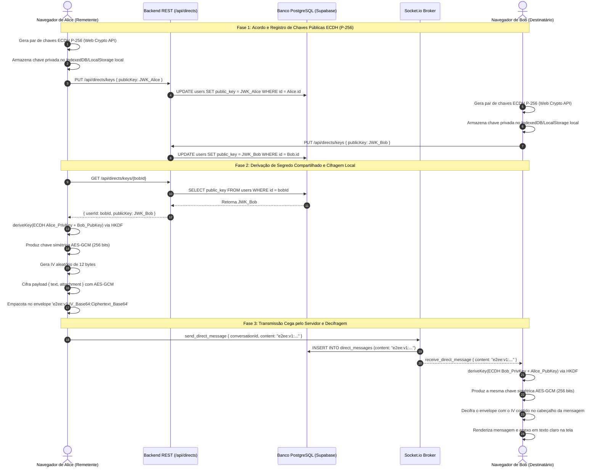

## Autor

Desenvolvido por **Lucas Ramos Silva, Wssihélio Vasconcelos, Ruan Victor e Gabriel Lobão.** como parte da disciplina de Programação Web II.

## Testes ponta a ponta (E2E)

A suíte Playwright (`e2e/`) sobe sozinha um backend de teste (SQLite em memória, porta 3101) e o frontend (Vite, porta 5273) e cobre cadastro/login, chat em tempo real, histórico paginado (rolagem infinita e exportação), Directs com criptografia ponta a ponta e anexos (documento e áudio).

```bash
npm install
npm run test:e2e:install   # baixa o Chromium (uma vez)
npm run test:e2e
```
