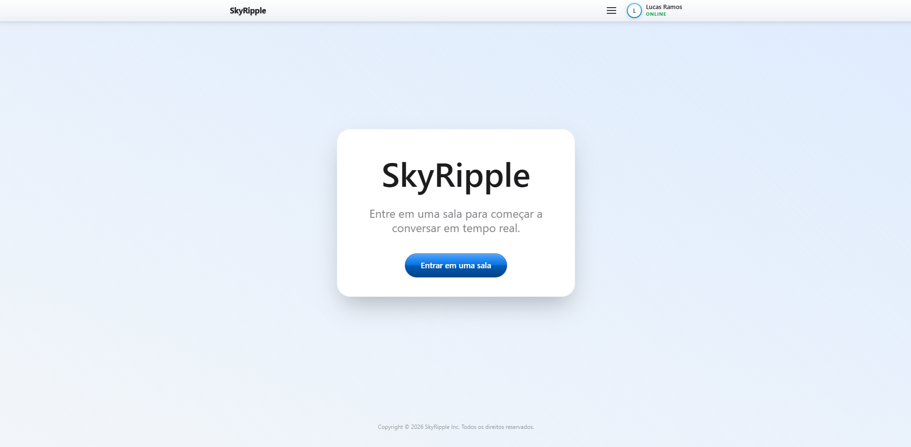
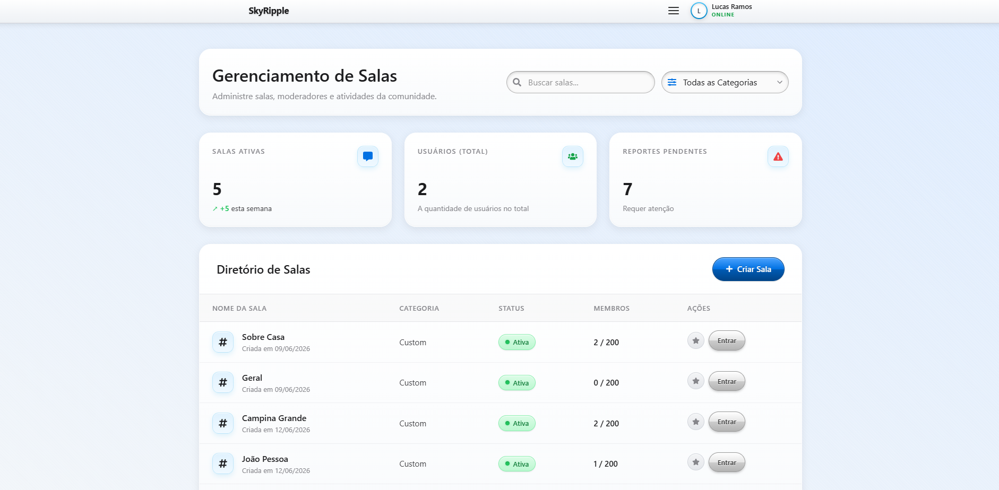
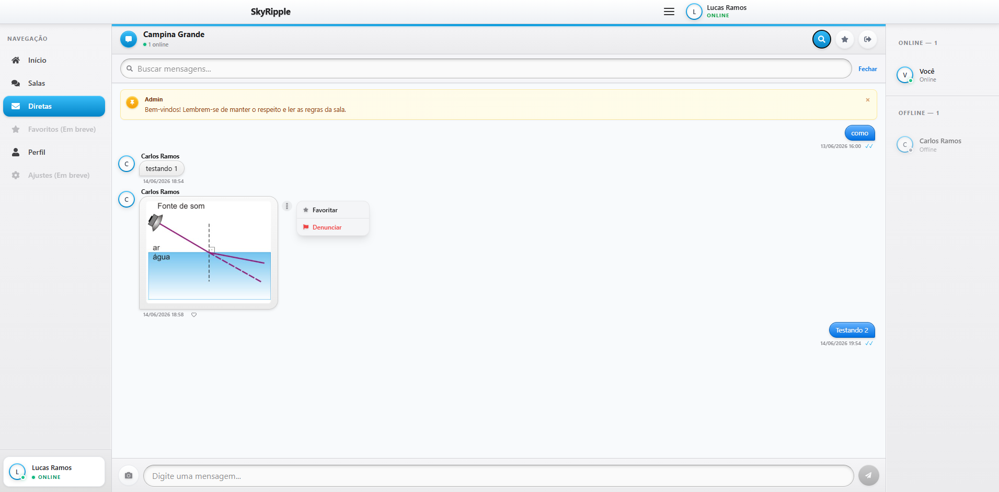
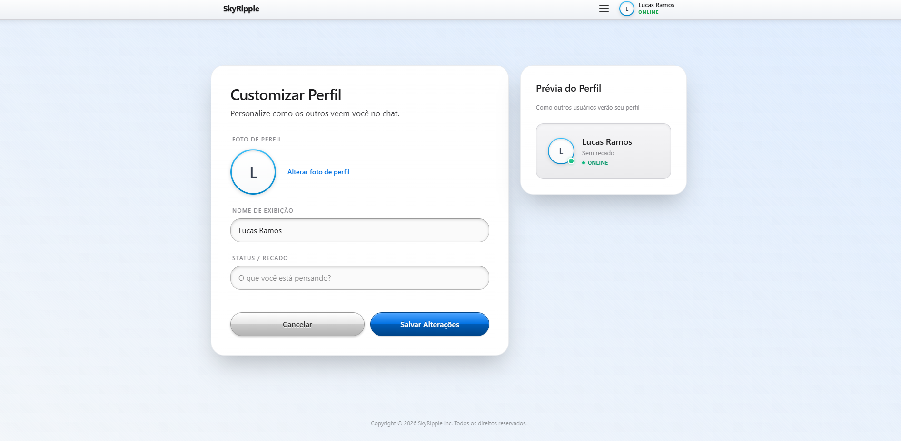

# SkyRipple

<div align="center">
  
</div>


O SkyRipple é uma aplicação web de chat em tempo real onde os usuários podem se conectar, entrar em salas temáticas e trocar mensagens instantaneamente. O projeto foca em uma experiência rica e nostálgica, trazendo uma estética clean com identidade visual inspirada no Web 2.0 Gloss (Skeuomorfismo e com influências do Frutiger Aero) aliada a tecnologias web modernas.

## O que o projeto faz

O SkyRipple funciona como um ponto de encontro virtual. De forma simples, ele permite:

* Criar uma conta e fazer login;
* Visualizar e favoritar diferentes salas de conversa;
* Entrar em salas e conversar em tempo real com outras pessoas;
* Personalizar o seu perfil (nome e recado/status);
* Usar o sistema de busca interna do chat para encontrar mensagens;
* Navegar de forma confortável tanto no Modo Claro quanto no Modo Escuro (com o visual dos botões e painéis se adaptando).

## Qual problema ele resolve

Este projeto foi construído como um projeto prático para a disciplina de Programação Web II. Ele resolve o problema básico de comunicação em tempo real em grupos, servindo como um excelente laboratório para conectar conceitos avançados de desenvolvimento, tais como:

* Criação de interfaces ricas e responsivas no frontend;
* Construção de uma API robusta no backend;
* Autenticação e segurança com JWT e criptografia de senhas;
* Comunicação bidirecional em tempo real usando WebSockets;
* Arquitetura visual híbrida, combinando a agilidade do Tailwind CSS com o controle detalhado do CSS para criar efeitos visuais.

## Tecnologias usadas

### Frontend

* React 19
* Vite
* Tailwind CSS 4
* CSS Híbrido (para efeitos com muitos detalhes, brilhos e profundidade)
* React Router DOM
* React Icons
* Socket.IO Client
* Vitest

### Backend

* Node.js
* Express
* Socket.IO
* Supabase (banco de dados em nuvem)
* Bibliotecas de segurança e utilidades (bcryptjs, jsonwebtoken, cors, dotenv, helmet e express-rate-limit)
* Arquitetura de banco de dados centralizada no Node.js (Supabase RLS Desativado)
* Testes unitários e de integração (Jest, Supertest, Socket.IO Client)
* ORM (Supabase + Sequelize)

### Ferramentas

* Git / GitHub
* Render (deploy do Backend)
* Vercel (Deploy do Frontend)
* Supabase (banco de dados)
* npm

## Como rodar localmente

Para testar o projeto no seu computador, primeiro clone o repositório e entre na pasta:

```bash
git clone https://github.com/LucasRamosSilva-15/WebChat.git
cd WebChat
```

*(Nota: substitua a URL acima caso o repositório esteja em outro endereço no GitHub).*

### Frontend

Em um terminal, entre na pasta do frontend, instale as dependências e inicie o servidor de desenvolvimento:

```bash
cd frontend
npm install
npm run dev
```

Você também precisará criar um arquivo `.env` na raiz da pasta `frontend`:

```env
VITE_BACKEND_URL=http://localhost:3001
VITE_API_URL=http://localhost:3001/api
```

### Backend

Em outro terminal, entre na pasta do backend, instale as dependências e inicie o servidor:

```bash
cd backend
npm install
npm run dev
```

Crie um arquivo `.env` na raiz da pasta `backend` com as variáveis necessárias (ajuste as chaves do Supabase e o JWT_SECRET conforme o seu ambiente):

```env
PORT=3001
JWT_SECRET=sua_chave_secreta_aqui
USE_MOCK_DB=false
SUPABASE_URL=sua_url_do_supabase
SUPABASE_ANON_KEY=sua_chave_anonima_do_supabase
FRONTEND_URL=http://localhost:5173
```
## Testes automatizados do backend e frontend

Em um terminal rode o comando

```bash
npm run test:backend && npm run test:frontend
```

## Link do deploy

* **Frontend:** [https://web-chat-project-web2.vercel.app](https://skyripple-project-web2.vercel.app/)
* **Backend/API:** [https://webchat-9vqr.onrender.com](https://webchat-9vqr.onrender.com)

## Imagens / Screenshots






## Funcionalidades

* [x] Página inicial (Home)
* [x] Login e Cadastro de contas com autenticação JWT e senhas criptografadas com bcrypt
* [x] Listagem e favoritação de salas
* [x] Chat em tempo real (envio e recebimento de mensagens instantâneas via WebSockets)
* [x] Busca avançada dentro do chat (filtro em tempo real e navegação entre resultados)
* [x] Customização de perfil do usuário (avatar, nome de exibição e recado/status)
* [x] Temas visuais: Modo Claro e Modo Escuro com estética Skeuomórfica / Web 2.0 Gloss
* [x] Layout responsivo e menus modais
* [x] Envio de imagens e anexos com compressão no cliente
* [x] Refinamentos na persistência e histórico de mensagens
* [x] Testes automatizados (125 testes no backend com Jest/Supertest e 59 testes no frontend com Vitest)
* [x] Documentação interativa da API (Swagger UI local/produção e Mintlify)
* [x] Endurecimento de Segurança CIS Controls IG1 & OWASP ASVS (Rate Limiting rigoroso, Helmet com HSTS, Sanitização XSS, Auditoria de Segurança)
* [x] Mensagens Diretas (Directs / Chat Privado) com histórico persistido e conversas individuais
* [x] Central de Notificações em tempo real com contador de não-lidas e sincronização via WebSockets
* [x] Sistema de Dono de Sala e Moderação Hierárquica (Promover/Rebaixar moderadores, Expulsar participantes, Transferir liderança da sala e Moderação de mensagens)
* [x] Edição de dados da sala (nome e descrição) pelo Dono da Sala
* [x] Sistema de denúncias (Reports) e feedback integrado
* [x] Painel Administrativo centralizado (Admin Dashboard)
* [ ] Histórico com paginação baseada em cursor (*Cursor-Based Pagination*) (Próximo passo)
* [ ] Criptografia Ponta-a-Ponta (*E2EE*) com chaves assimétricas via Web Crypto API (Próximo passo)

## Estrutura do projeto

```txt
.
├── backend/
│   ├── src/
│   │   ├── config/
│   │   │   └── database.js             # Conexão e pooling Sequelize / Supabase
│   │   ├── controllers/
│   │   │   ├── AuthController.js
│   │   │   ├── DirectController.js
│   │   │   ├── MessageController.js
│   │   │   ├── NotificationController.js
│   │   │   ├── RoomController.js
│   │   │   └── ...
│   │   ├── middleware/
│   │   │   ├── auth.js                 # Validação JWT e identificação de usuário
│   │   │   └── adminAuth.js            # Proteção de rotas administrativas
│   │   ├── models/
│   │   │   ├── User.js
│   │   │   ├── Room.js
│   │   │   ├── RoomMember.js
│   │   │   ├── Message.js
│   │   │   ├── DirectConversation.js
│   │   │   ├── DirectMessage.js
│   │   │   ├── Notification.js
│   │   │   └── ...
│   │   ├── repositories/
│   │   │   ├── UserRepository.js
│   │   │   ├── RoomRepository.js
│   │   │   ├── RoomMemberRepository.js
│   │   │   ├── MessageRepository.js
│   │   │   ├── DirectRepository.js
│   │   │   └── NotificationRepository.js
│   │   ├── routes/
│   │   │   ├── api.js                  # Roteador central de APIs
│   │   │   ├── admin.js                # Rotas do painel administrativo
│   │   │   ├── roomRoutes.js           # Rotas de salas e moderação
│   │   │   ├── directRoutes.js         # Mensagens diretas privadas
│   │   │   └── notificationRoutes.js   # Notificações em tempo real
│   │   ├── services/
│   │   │   ├── UserService.js
│   │   │   ├── RoomService.js          # Lógica de negócio, cargos e moderação
│   │   │   ├── MessageService.js
│   │   │   ├── DirectService.js
│   │   │   └── NotificationService.js
│   │   └── utils/
│   │       ├── security.js             # Criptografia, JWT e sanitização XSS
│   │       └── auditLogger.js          # Auditoria de segurança estruturada
│   ├── tests/                          # 14 suítes e 125 testes Jest/Supertest
│   │   ├── roomModeration.test.js
│   │   ├── room.test.js
│   │   ├── message.test.js
│   │   ├── directs.test.js
│   │   ├── authMiddleware.test.js
│   │   └── ...
│   ├── server.js                       # Servidor Express, WebSockets e Swagger
│   ├── package.json
│   └── README.md                       # Documentação técnica profunda do backend
├── docs/                               # Documentação técnica e Mintlify
├── frontend/
│   ├── src/
│   │   ├── assets/                     # SVGs, ícones e recursos visuais
│   │   ├── components/
│   │   │   ├── MembersSidebar.jsx      # Painel de membros e moderação tátil
│   │   │   ├── ChatSidebar.jsx         # Lista de conversas e salas no chat
│   │   │   ├── Navbar.jsx              # Barra superior e navegação
│   │   │   ├── NotificationsDropdown.jsx # Dropdown de notificações em tempo real
│   │   │   ├── UserAvatar.jsx          # Avatar com indicador de presença
│   │   │   └── ...
│   │   ├── context/
│   │   │   └── NotificationContext.jsx # Estado global de notificações
│   │   ├── pages/
│   │   │   ├── Home.jsx
│   │   │   ├── Chat.jsx                # Interface principal de conversação
│   │   │   ├── Directs.jsx             # Mensagens diretas (1-a-1)
│   │   │   ├── Rooms.jsx               # Catálogo e criação de salas
│   │   │   ├── Admin.jsx               # Painel administrativo do sistema
│   │   │   ├── Feedback.jsx            # Formulário de feedback e suporte
│   │   │   ├── Settings.jsx            # Configurações do perfil
│   │   │   └── ...
│   │   ├── services/
│   │   │   └── api.js                  # Cliente fetch autenticado
│   │   ├── styles/
│   │   │   ├── skeuo.css               # Tokens de design Web 2.0 Gloss
│   │   │   └── chat.css
│   │   ├── tests/                      # 11 suítes e 59 testes Vitest
│   │   │   ├── chat.test.jsx
│   │   │   ├── Directs.test.jsx
│   │   │   ├── MembersSidebar.test.jsx
│   │   │   └── ...
│   │   ├── App.jsx                     # Rotas e layout principal
│   │   ├── socket.js                   # Instância global do Socket.IO Client
│   │   ├── main.jsx                    # Ponto de montagem React 19
│   │   └── index.css                   # Tailwind 4 e estilos base
│   ├── vite.config.js
│   ├── package.json
│   └── .env
└── README.md
```

## Status atual

O projeto **SkyRipple** encontra-se em estado avançado de maturidade técnica, estabilidade e conformidade arquitetural:
* **Frontend**: Totalmente integrado via REST e WebSockets, contando com interface skeuomórfica refinada (Modo Claro/Escuro), chat em salas públicas e privadas, mensagens diretas (Directs), central de notificações em tempo real, painel administrativo e interface tátil de moderação de sala (promover/rebaixar, expulsar participantes e transferir dono).
* **Backend**: Arquitetura profissional em camadas (Controllers, Services, Repositories e Models ORM com Sequelize e Supabase PostgreSQL), endurecimento de segurança baseado nos padrões **CIS Controls IG1 & OWASP ASVS**, logs estruturados de auditoria, suíte robusta com 125 testes automatizados aprovados e documentação Swagger 3.0 interativa.

## Link da documentação Swagger

* **Produção:** <https://webchat-9vqr.onrender.com/api-docs/>
* **Local:** <http://localhost:3001/api-docs/>

## Link da documentação Mintlify

<https://lucas-ramos.mintlify.site/guides/overview>

## Próximos passos

* **Paginação por Cursor no Histórico**: Implementar parâmetros `before`/`since`/`limit` com índices B-Tree sobre mensagens para rolagem infinita escalável em salas com milhões de registros.
* **Criptografia Ponta-a-Ponta (E2EE)**: Implementação de criptografia assimétrica ponta-a-ponta no cliente para canais privados (Directs) através da Web Crypto API.
* **Mídias e Arquivos**: Suporte nativo a envio e pré-visualização de áudio gravado e documentos em anexo.
* **Testes End-to-End (E2E)**: Criação de suíte de testes de ponta a ponta com Playwright automatizando a jornada completa do usuário.

## Diagrama ER


## Diagrama de Classes

.svg)

## Autor

Desenvolvido por **Lucas Ramos Silva, Wssihélio Vasconcelos, Ruan Victor e Gabriel Lobão.** como parte da disciplina de Programação Web II.
