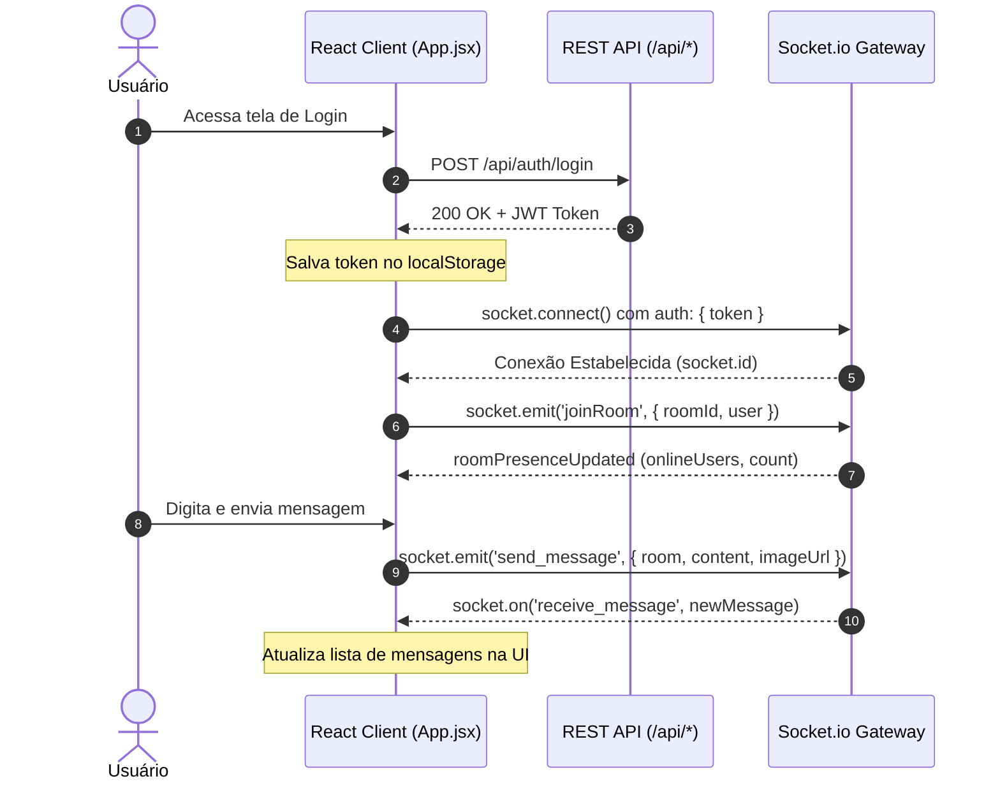

O frontend do **WebChat** é uma Single Page Application (SPA) construída com **React 19**, empacotada via **Vite 8** e estilizada sob uma identidade visual **AeroGlass & SkyRipple** através de **Tailwind CSS v4** e módulos skeuomórficos dedicados.


---

## Estrutura de Diretórios (`/frontend/src`)

A estrutura do código-fonte segue o princípio de separação de responsabilidades e isolamento de efeitos colaterais:

```
frontend/src/
├── components/          # Componentes reutilizáveis do sistema e guardas de rota
│   ├── UserAvatar.jsx   # Avatar tátil com anéis de presença e iniciais
│   ├── SkeuoLoading.jsx # Indicador de carregamento com shimmer e barra física
│   ├── SkyBackground.jsx# Fundo dinâmico com gradiente atmosférico
│   ├── Navbar.jsx       # Barra de navegação e controle de perfil/tema
│   ├── ChatSidebar.jsx  # Barra lateral de navegação entre canais
│   ├── MembersSidebar.jsx# Lista lateral de participantes da sala ativa
│   ├── PrivateRoute.jsx # HOC de proteção para rotas de usuário autenticado
│   └── AdminRoute.jsx   # HOC de proteção para rotas administrativas
├── pages/               # Visões completas roteadas pelo React Router DOM v7
│   ├── Home.jsx         # Landing page de apresentação
│   ├── Login.jsx        # Formulário de entrada com JWT
│   ├── Register.jsx     # Cadastro de novas contas
│   ├── Rooms.jsx        # Catálogo e criação de salas
│   ├── Chat.jsx         # Interface principal de mensageria em tempo real
│   ├── Admin.jsx        # Painel operacional de moderação e métricas
│   └── ButtonsTest.jsx  # Bancada de testes e vitrine viva de componentes
├── services/            # Camada de comunicação HTTP
│   └── api.js           # Cliente fetch com interceptor de token e auto-logout
├── styles/              # Módulos CSS do Design System Skeuomórfico
│   ├── skeuo.css        # Relevos, chanfros, botões e cartões físicos
│   ├── skeuo-extra.css  # Vidro jateado (glassmorphism) e efeitos de luz
│   ├── animations.css   # Keyframes de pulso, shimmer e transições
│   ├── avatar.css       # Molduras, anéis e cores de status
│   └── loading.css      # Barras de progresso e spinners
├── socket.js            # Instância singleton do cliente Socket.io
├── index.css            # Ponto de entrada Tailwind v4 e variáveis de tema
└── main.jsx             # Bootstrap da aplicação React
```

---

## Gerenciamento de Estado e Ciclo de Vida da Sessão

A aplicação adota uma estratégia de estado leve e desacoplada, utilizando **LocalStorage** sincronizado com **Custom Events** do navegador para comunicação inter-componentes sem overhead de bibliotecas pesadas:

<CardGroup cols={3}>
  <Card title="Autenticação JWT" icon="id-card" color="#2563EB">
    Armazenamento seguro do token no `localStorage('chat_token')` com inclusão automática em headers `Authorization: Bearer`.
  </Card>
  <Card title="Event Bus Nativo" icon="satellite-dish" color="#10B981">
    Disparo de `window.dispatchEvent(new Event('profileUpdated'))` e `sessionExpired` para reagir a alterações de perfil e logout.
  </Card>
  <Card title="Sincronização de Salas" icon="layer-group" color="#F59E0B">
    Persistência das salas conectadas em `chat_joinedRooms` para reconexão automática após refresh de página.
  </Card>
</CardGroup>

---

## Fluxo de Comunicação: REST API e WebSocket

O frontend opera em dois canais concorrentes gerenciados transparentemente:



---

## Interceptor Central de API (`services/api.js`)

Todas as requisições HTTP passam pela função `apiRequest`, que aplica automaticamente o Bearer Token e intercepta status `401 Unauthorized`:

```javascript
// Exemplo simplificado de services/api.js
export const apiRequest = async (endpoint, options = {}) => {
  const token = localStorage.getItem('chat_token');
  const headers = {
    'Content-Type': 'application/json',
    ...options.headers,
    ...(token ? { 'Authorization': `Bearer ${token}` } : {})
  };

  const response = await fetch(`${API_URL}${endpoint}`, { ...options, headers });

  if (!response.ok) {
    if (response.status === 401) {
      clearAuthSession(); // Dispara evento de expiração de sessão
    }
    const err = await response.json().catch(() => ({}));
    throw new Error(err.error || response.statusText);
  }

  return response.json();
};
```
