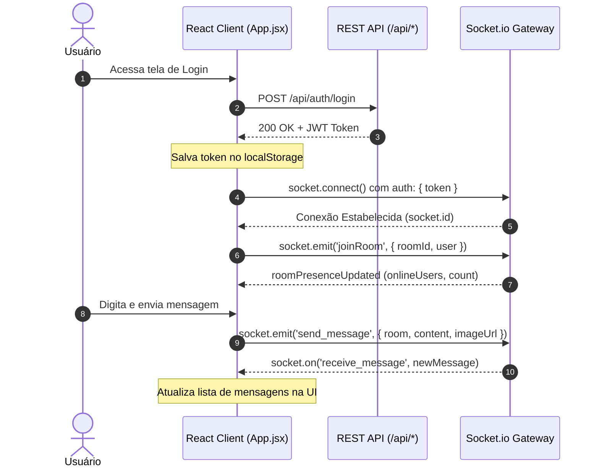

O frontend do **SkyRipple** é uma Single Page Application (SPA) construída com **React 19**, empacotada via **Vite 8** e estilizada sob uma identidade visual **AeroGlass & SkyRipple** através de **Tailwind CSS v4** e módulos skeuomórficos dedicados.


---

## Estrutura de Diretórios (`/frontend/src`)

A estrutura do código-fonte segue o princípio de separação de responsabilidades e isolamento de efeitos colaterais:

```
frontend/src/
├── components/          # Componentes reutilizáveis do sistema e guardas de rota
│   ├── common/          # Componentes atômicos e utilitários
│   │   └── OtpCodeInput.jsx # Seletor numérico de slots OTP (6 e 8 dígitos)
│   ├── UserAvatar.jsx   # Avatar tátil com anéis de presença e iniciais
│   ├── SkeuoLoading.jsx # Indicador de carregamento com shimmer e barra física
│   ├── SkyBackground.jsx# Fundo dinâmico com gradiente atmosférico
│   ├── Navbar.jsx       # Barra superior com busca, status de conexão e menus
│   ├── ChatSidebar.jsx  # Barra lateral de navegação entre salas ativas
│   ├── MembersSidebar.jsx# Moderação e presença de membros (Dono, Mod, Membro)
│   ├── ChatQuickSettings.jsx# Menu de densidade visual e preferências sonoras
│   ├── NotificationsDropdown.jsx# Menu popover de notificações com contador pulsante
│   ├── NotificationToastContainer.jsx# Banners táteis flutuantes de alertas
│   ├── NewDirectMessageModal.jsx# Modal de busca e criação de conversas diretas
│   ├── CookieBanner.jsx # Banner de privacidade LGPD/GDPR
│   ├── PrivateRoute.jsx # HOC de proteção para rotas de usuário autenticado
│   └── AdminRoute.jsx   # HOC de proteção para rotas administrativas
├── context/             # Gerenciamento de estado global reativo
│   └── NotificationContext.jsx # Provider global de notificações e feedback sonoro
├── pages/               # Visões completas roteadas pelo React Router DOM v7
│   ├── Home.jsx         # Landing page de apresentação
│   ├── Login.jsx        # Formulário de entrada com JWT e Google OAuth
│   ├── Register.jsx     # Cadastro em duas etapas com código OTP de 6 dígitos
│   ├── ForgotPassword.jsx # Recuperação de credenciais com OTP de 8 dígitos
│   ├── Rooms.jsx        # Lobby de salas com filtros e métricas
│   ├── Chat.jsx         # Interface principal de mensageria com cursor, áudio e anexos
│   ├── Directs.jsx      # Mensagens Diretas 1x1 com Criptografia E2EE e busca
│   ├── Favorites.jsx    # Central de curadoria de salas e conversas favoritas
│   ├── Custom.jsx       # Personalização de avatar e perfil
│   ├── Settings.jsx     # Preferências visuais, temas e acessibilidade
│   ├── Feedback.jsx     # Central de sugestões, bugs e elogios com anexos
│   ├── Suporte.jsx      # FAQ acordeão, canais de contato e transparência
│   ├── About.jsx        # Apresentação institucional e acadêmica
│   ├── AdminLogin.jsx   # Acesso ao painel com senha mestra
│   ├── Admin.jsx        # Painel operacional de moderação e métricas
│   ├── ButtonsTest.jsx  # Bancada de testes e vitrine viva de componentes
│   └── NotFound.jsx     # Página 404 personalizada com bússola 3D
├── services/            # Camada de comunicação HTTP, Web Crypto e Mídia
│   ├── api.js           # Cliente fetch com interceptor de token e auto-logout
│   ├── attachments.js   # Conversão de áudio, validação e sanitização de anexos (até 5MB)
│   └── e2ee.js          # Web Crypto API: ECDH P-256, HKDF e AES-GCM-256
├── styles/              # Módulos CSS do Design System Skeuomórfico
│   ├── skeuo.css        # Relevos, chanfros, botões e cartões físicos
│   ├── skeuo-extra.css  # Vidro jateado (glassmorphism) e efeitos de luz
│   ├── animations.css   # Keyframes de pulso, shimmer e transições
│   ├── avatar.css       # Molduras, anéis e cores de status
│   └── loading.css      # Barras de progresso e spinners
├── tests/               # Suíte de testes automatizados com Vitest (20 arquivos e 136 testes 100% aprovados)
├── socket.js            # Instância singleton do cliente Socket.io
├── index.css            # Ponto de entrada Tailwind v4 e variáveis de tema
└── main.jsx             # Bootstrap da aplicação React
```

<Note>
**Ecossistema Híbrido**: Além da aplicação Web SPA contida em `frontend/`, o projeto conta com o aplicativo móvel nativo em `mobile/` (Capacitor 8 Android), compartilhando a mesma base de design system skeuomórfico, endpoints da API e contratos de Criptografia Ponta a Ponta. Para detalhes sobre o aplicativo móvel, consulte a página dedicada [App Mobile (Android)](/frontend/mobile).
</Note>

---

## Tabela de Rotas da Aplicação (`App.jsx`)

| Rota | Componente | Guarda de Acesso | Propósito |
| :--- | :--- | :--- | :--- |
| `/` | `Home.jsx` | Pública | Landing page inicial |
| `/login` | `Login.jsx` | Pública | Autenticação com e-mail e senha |
| `/register` | `Register.jsx` | Pública | Criação de conta com medidor de senha |
| `/about` | `About.jsx` | Pública | Apresentação institucional |
| `/rooms` | `Rooms.jsx` | `PrivateRoute` | Catálogo de salas de chat e métricas |
| `/chat` | `Chat.jsx` | `PrivateRoute` | Sala de chat ativa e moderação |
| `/directs` | `Directs.jsx` | `PrivateRoute` | Bate-papo direto privado 1x1 |
| `/favorites`| `Favorites.jsx`| `PrivateRoute` | Hub de salas e conversas favoritas |
| `/custom` | `Custom.jsx` | `PrivateRoute` | Personalização de avatar e status |
| `/settings`| `Settings.jsx`| `PrivateRoute` | Temas Claro/Escuro e acessibilidade |
| `/feedback`| `Feedback.jsx`| `PrivateRoute` | Envio de avaliações e bugs com fotos |
| `/suporte` | `Suporte.jsx` | `PrivateRoute` | Central de ajuda e FAQ interativo |
| `/admin-login`| `AdminLogin.jsx`| Pública | Acesso com chave mestra admin |
| `/admin` | `Admin.jsx` | `AdminRoute` | Console de governança e métricas |
| `/buttons` | `ButtonsTest.jsx`| Pública | Laboratório de componentes visuais |
| `*` | `NotFound.jsx` | Pública | Rota 404 personalizada |

---

## Gerenciamento de Estado e Ciclo de Vida da Sessão

A aplicação adota uma estratégia de estado leve e desacoplada, utilizando **NotificationContext**, **LocalStorage** e **Custom Events** do navegador para comunicação inter-componentes sem overhead de bibliotecas pesadas:

<CardGroup cols={3}>
  <Card title="Autenticação JWT" icon="id-card" color="#2563EB">
    Armazenamento seguro do token no `localStorage('chat_token')` com inclusão automática em headers `Authorization: Bearer`.
  </Card>
  <Card title="Central de Notificações" icon="bell" color="#8B5CF6">
    Estado reativo com `NotificationContext`, persistência em cache local e bips de áudio em tempo real.
  </Card>
  <Card title="Event Bus Nativo" icon="satellite-dish" color="#10B981">
    Disparo de `profileUpdated` e `sessionExpired` para reagir a alterações de perfil e logout imediato.
  </Card>
</CardGroup>

---

## Fluxo de Comunicação: REST API e WebSocket

O frontend opera em dois canais concorrentes gerenciados transparentemente:



---

## Interceptor Central de API (`services/api.js`)

Todas as requisições HTTP passam pela função `apiRequest`, que aplica automaticamente o Bearer Token e intercepta status `401 Unauthorized`:

```javascript
export const apiRequest = async (endpoint, options = {}) => {
  const token = localStorage.getItem('chat_token');
  const headers = {
    'Content-Type': 'application/json',
    ...options.headers,
    ...(token ? { 'Authorization': `Bearer ${token}` } : {})
  };

  const response = await fetch(`${API_URL}${endpoint}`, { ...options, headers });

  if (!response.ok) {
    if (response.status === 401) {
      clearAuthSession();
    }
    const err = await response.json().catch(() => ({}));
    throw new Error(err.error || response.statusText);
  }

  return response.json();
};
```
