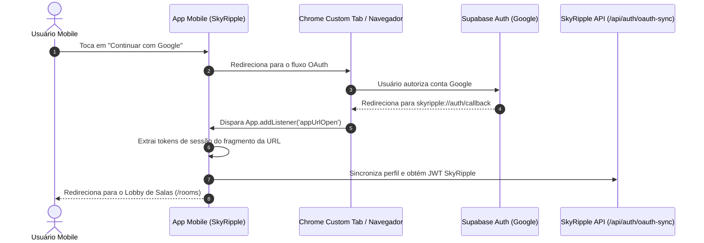

O **SkyRipple Mobile** é o aplicativo móvel dedicado da plataforma, empacotado como uma aplicação híbrida de alta performance para Android através do **Capacitor 8**, utilizando **React 19**, **Vite** e **Tailwind CSS v4**.


---

## 📱 Visão Geral & Especificações Nativas

O aplicativo móvel foi projetado para oferecer uma experiência tátil fluida, integrando recursos de hardware do dispositivo como feedback háptico, teclado virtual redimensionável e suporte total a telas com entalhes e barras de navegação (Safe Area Insets):

<CardGroup cols={3}>
  <Card title="Capacitor 8 Core" icon="android" color="#3DDC84">
    Empacotamento nativo Android com pacote `com.skyripple.app` ("SkyRipple") e compatibilidade estrita com Android 14+.
  </Card>
  <Card title="Deep Linking Nativo" icon="link" color="#2563EB">
    Tratamento de URL Schemes `skyripple://auth/callback` para login federado com Google OAuth.
  </Card>
  <Card title="Criptografia E2EE Móvel" icon="shield-halved" color="#10B981">
    Cifragem local Web Crypto API (ECDH P-256 + AES-GCM) preservando privacidade absoluta em mensagens diretas.
  </Card>
</CardGroup>

---

## ⚙️ Configuração do Capacitor (`capacitor.config.json`)

O arquivo de configuração do projeto define os metadados da aplicação e o comportamento dos plugins nativos:

```json
{
  "appId": "com.skyripple.app",
  "appName": "SkyRipple",
  "webDir": "dist",
  "bundledWebRuntime": false,
  "plugins": {
    "Keyboard": {
      "resize": "native",
      "style": "DARK",
      "resizeOnFullScreen": true
    },
    "StatusBar": {
      "overlaysWebView": true
    },
    "GoogleAuth": {
      "scopes": ["profile", "email"],
      "forceCodeForRefreshToken": true
    }
  }
}
```

---

## 🔗 Deep Linking & Autenticação Google OAuth

Para garantir que o fluxo de login social funcione sem fricção e retorne ao aplicativo móvel após a autorização no navegador, o SkyRipple utiliza um handler de Deep Linking configurado em `mobile/src/App.jsx` com o plugin `@capacitor/app`:



### Implementação do Listener no Cliente Mobile:

```javascript
import { App as CapApp } from '@capacitor/app';
import { supabase } from './services/supabase';

useEffect(() => {
  const sub = CapApp.addListener('appUrlOpen', async ({ url }) => {
    if (!url || !url.includes('auth/callback')) return;

    try {
      const hash = url.split('#')[1] || '';
      const params = new URLSearchParams(hash || url.split('?')[1]);
      const accessToken = params.get('access_token');
      const refreshToken = params.get('refresh_token');

      if (accessToken) {
        await supabase.auth.setSession({
          access_token: accessToken,
          refresh_token: refreshToken || '',
        });
        navigate('/rooms', { replace: true });
      }
    } catch (err) {
      console.error('Falha ao processar deep link:', err);
    }
  });

  return () => {
    sub.then(handle => handle.remove());
  };
}, [navigate]);
```

---

## 🎨 Otimizações Visuais & Safe Area Insets

### 1. Eliminação de Artefatos de GPU no WebView
No Android WebView, a propriedade CSS `backdrop-filter: blur(...)` em elementos fixos frequentemente produz renderizações com blocos pretos opacos. No componente `MobileHeader.jsx`, essa questão foi solucionada aplicando cores sólidas com leve opacidade e isolamento explícito de camada:

```jsx
<header
  className="fixed top-0 left-0 right-0 z-40 bg-slate-950/95 border-b border-white/10"
  style={{
    paddingTop: 'env(safe-area-inset-top)',
    transform: 'translateZ(0)',
    willChange: 'transform'
  }}
>
  {/* Conteúdo do Cabeçalho */}
</header>
```

### 2. Espaçamento Inferior Ergonômico (Bottom Navigation)
Para evitar sobreposição com o indicador de gestos do Android e com a barra de navegação inferior (`BottomNavigation`), as páginas adotam o cálculo dinâmico de preenchimento:

```css
padding-bottom: calc(6.5rem + env(safe-area-inset-bottom));
```

---

## 🕒 Fuso Horário Brasileiro (`America/Sao_Paulo` / 24h)

Tanto nas salas de bate-papo quanto nas conversas privadas (Directs), os timestamps são uniformemente formatados de acordo com o horário de Brasília (`America/Sao_Paulo`), corrigindo offsets UTC e padronizando a exibição para 24 horas via `mobile/src/utils/dateUtils.js`:

```javascript
export function formatMessageTime(dateInput) {
  if (!dateInput) return '';
  const date = dateInput instanceof Date ? dateInput : new Date(dateInput);
  if (isNaN(date.getTime())) return '';

  return new Intl.DateTimeFormat('pt-BR', {
    timeZone: 'America/Sao_Paulo',
    hour: '2-digit',
    minute: '2-digit',
    hour12: false
  }).format(date);
}
```

---

## 🚀 Como Executar e Compilar o Aplicativo

### Modo Web (Desenvolvimento Local)
Permite prototipar a interface mobile rapidamente através do navegador com emulação de dispositivo:

```bash
cd mobile
npm install
npm run dev
```

### Sincronização com o Android Nativo
Compila o bundle React 19 e sincroniza os arquivos para o diretório `mobile/android/`:

```bash
npm run build
npx cap sync android
```

### Abrir no Android Studio
Para gerar o APK (Debug ou Release assinado) ou depurar em dispositivo físico via ADB:

```bash
npx cap open android
```
