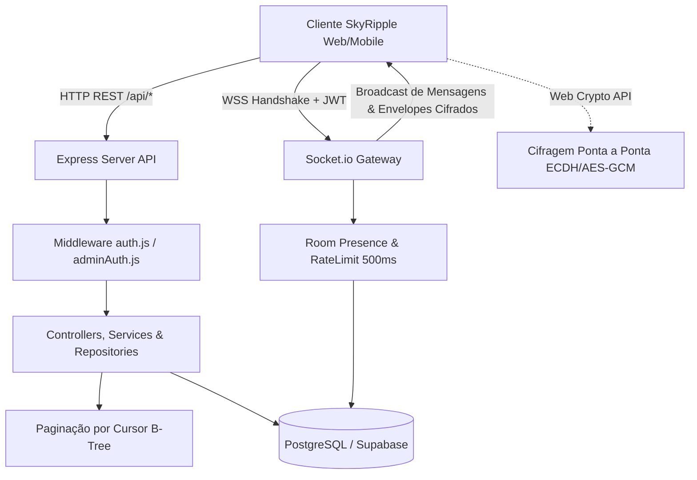

O **SkyRipple** é uma plataforma de comunicação em tempo real de alto desempenho, projetada sob uma arquitetura híbrida que combina uma robusta API RESTful (Express/Node.js) com um pipeline de mensageria bidirecional via WebSockets (Socket.io) e persistência relacional (PostgreSQL / Supabase / Prisma).

---

## Pilares Arquiteturais

A infraestrutura foi concebida para oferecer baixa latência na entrega de mensagens, consistência transacional e isolamento estrito entre usuários e operadores administrativos:

<CardGroup cols={3}>
  <Card title="Camada RESTful" icon="server" color="#2563EB">
    Rotas HTTP padronizadas, hashing Argon2id/bcrypt, autenticação híbrida (Google OAuth via Supabase), verificação OTP e emissão de JWT.
  </Card>
  <Card title="Realtime & E2EE" icon="lock" color="#F59E0B">
    Pipeline WebSocket com Socket.io e suporte a Criptografia Ponta a Ponta (ECDH P-256 + AES-GCM-256) em conversas diretas.
  </Card>
  <Card title="Persistência Relacional" icon="database" color="#10B981">
    Banco de dados PostgreSQL com paginação por cursor (`before`, `since`, `limit`) sobre índices B-Tree e integridade referencial.
  </Card>
</CardGroup>

---

## Topologia do Sistema

O diagrama abaixo ilustra o fluxo de dados entre os clientes (Web/Mobile), a camada de aplicação Express, o subsistema de WebSockets e o banco relacional:

---

## Ambientes Disponíveis

Para integrar suas aplicações e realizar homologações, utilize as URLs base correspondentes:

| Ambiente | Base URL | WebSocket URL | Protocolo de Transporte |
| :--- | :--- | :--- | :--- |
| **Produção (SkyRipple)** | `https://skyripple-9vqr.onrender.com/api` | `wss://skyripple-9vqr.onrender.com` | HTTPS / WSS |
| **Produção (Legado)** | `https://webchat-9vqr.onrender.com/api` | `wss://webchat-9vqr.onrender.com` | HTTPS / WSS |
| **Desenvolvimento Local** | `http://localhost:3001/api` | `ws://localhost:3001` | HTTP / WS |

<Note>
**Healthcheck**: A rota raiz `GET /` do servidor responde `{ "status": "online", "service": "SkyRipple MVP API" }` sem exigir autenticação, ideal para monitoramento de liveness e readiness em orquestradores como Kubernetes ou Render.
</Note>

## Documentação Interativa & OpenAPI

O ecossistema **SkyRipple** conta com duas interfaces complementares para consumo e teste dos contratos de API:
* **Portal Mintlify**: Documentação aprofundada de arquitetura, guias de integração, design system de componentes frontend e referência interativa de endpoints.
* **Swagger UI (OpenAPI 3.0/3.1)**: Interface interativa embarcada no próprio backend em `/api-docs` (`https://skyripple-9vqr.onrender.com/api-docs` ou `http://localhost:3001/api-docs`), documentando **40 rotas** e **13 esquemas canônicos** com suporte a autenticação interativa via `BearerAuth` (JWT) e `AdminAuth` (chave mestra).
* **Maturidade Técnica & Testes**: Suíte robusta de **310 testes automatizados** (182 testes no backend com Jest e 128 testes no frontend com Vitest) com 100% de aprovação.

---

## Catálogo de Domínios da API

A API está dividida em 8 domínios operacionais fundamentais:

<CardGroup cols={2}>
  <Card title="1. Autenticação & Usuários" icon="user-lock" href="/guides/auth-security">
    Registro com Argon2id/bcrypt, verificação em duas etapas via OTP, login, Google OAuth (`oauth-sync`) e perfil (`/auth/me`).
  </Card>
  <Card title="2. Salas & Moderação" icon="people-roof" href="/api-reference/rooms/list">
    Salas temáticas, cargos hierárquicos (`owner`, `moderator`, `user`), expulsão de membros e transferência de dono.
  </Card>
  <Card title="3. Mensageria & Histórico" icon="message" href="/api-reference/messages/list">
    Histórico paginado por cursor (`before`, `since`, `limit`), anexos multimídia/áudio gravado (até 5MB) e busca textual.
  </Card>
  <Card title="4. Mensagens Diretas (Directs) & E2EE" icon="comments" href="/api-reference/directs/list-conversations">
    Conversas privadas 1x1, troca de chaves públicas ECDH P-256 (`/directs/keys`), trânsito de envelopes cifrados e histórico confidencial.
  </Card>
  <Card title="5. Notificações em Tempo Real" icon="bell" href="/api-reference/notifications/list">
    Central de avisos em tempo real com persistência, leitura individual ou em lote.
  </Card>
  <Card title="6. Favoritos" icon="star" href="/api-reference/favorites/list">
    Acesso rápido aos canais e conversas favoritas do usuário.
  </Card>
  <Card title="7. Governança & Moderação" icon="shield" href="/guides/communication-standards">
    Abertura de denúncias contra mensagens (`reports`) e canal direto de melhorias (`feedbacks`).
  </Card>
  <Card title="8. Painel Administrativo" icon="gauge" href="/api-reference/admin/stats">
    Métricas do cluster (`/stats`), banimento imediato de contas e moderação administrativa forçada.
  </Card>
</CardGroup>
